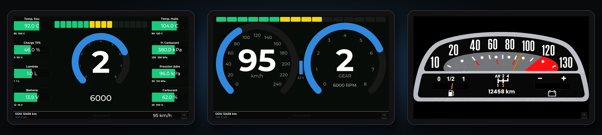
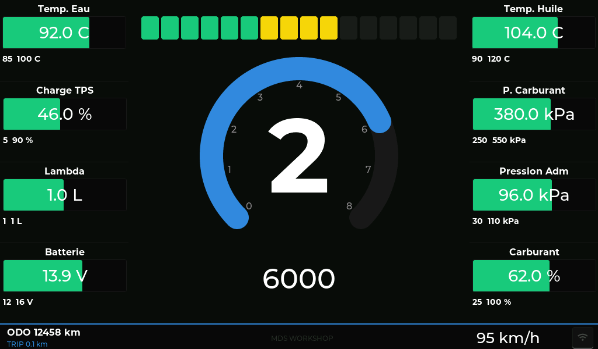
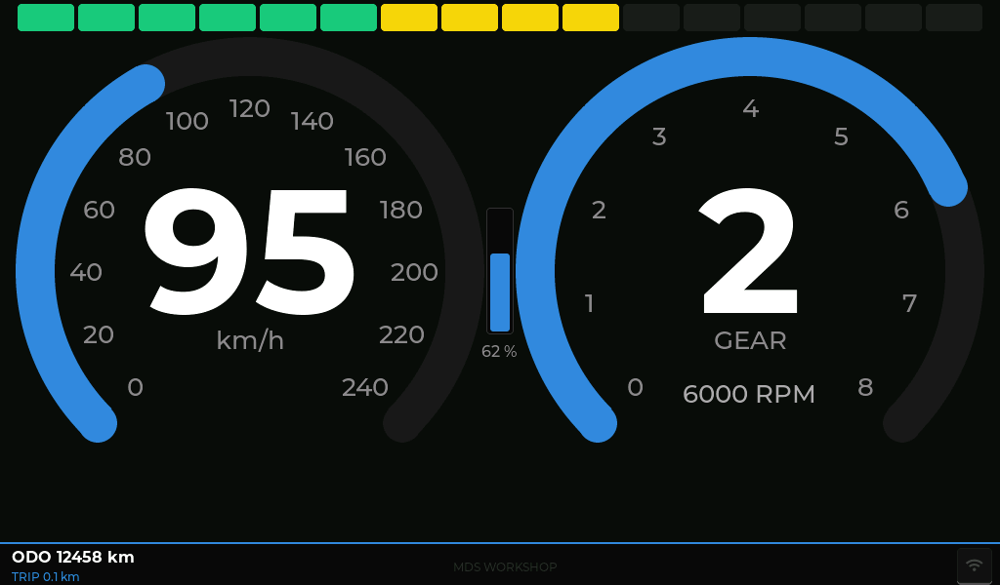
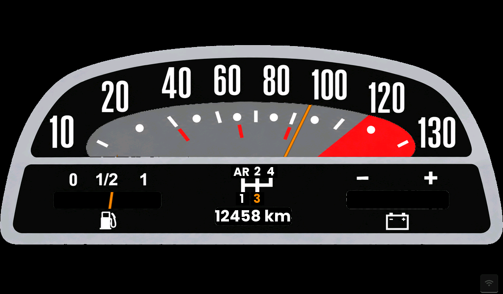

# MDS Dashboard

**Tableau de bord numérique 7 pouces pour voitures de compétition**

*par MDS Workshop*

[Mettre à jour mon écran](#mettre-à-jour-lécran) · [Nouveautés](CHANGELOG.md) · [Télécharger le firmware](firmware/) · [Notice (PDF)](docs/Notice_MDS_Dashboard.pdf)

---

## En bref

Le MDS Dashboard remplace ou complète le combiné d'origine par un écran tactile de 7 pouces. Il lit les informations du calculateur moteur par le bus CAN et les affiche en clair : régime, rapport engagé, vitesse, températures, pressions, richesse… avec des alertes plein écran quand une valeur sort de la plage normale.

Tout se règle depuis un téléphone, sans application à installer : l'écran crée son propre réseau Wi-Fi et ouvre une page de réglages.

## Les écrans

Au démarrage, l'écran affiche la vue **Route**. Un appui sur le bouton du volant (ou au centre de l'écran) bascule sur le **deuxième écran**, choisi dans les réglages.

<table>
<tr>
<td width="50%"></td>
<td width="50%"></td>
</tr>
<tr>
<td><b>Route</b> — 8 valeurs moteur au choix, chacune avec sa barre de couleur (bleu : trop bas, vert : normal, rouge : trop haut), jauge de régime avec zone rouge, shift light, rapport engagé en grand, vitesse, compteur kilométrique et trip.</td>
<td><b>Course</b> — l'essentiel, lisible d'un coup d'œil : deux grandes jauges vitesse et régime, rapport engagé, niveau d'essence et shift light sur toute la largeur.</td>
</tr>
<tr>
<td width="50%"></td>
<td></td>
</tr>
<tr>
<td><b>Compteur 2CV</b> — un cadran à aiguilles dans l'esprit du compteur de la Citroën 2CV : aiguilles vitesse et essence animées, rapport engagé surligné sur la grille de boîte, kilométrage.</td>
<td></td>
</tr>
</table>

## Fonctions

- **Lecture du calculateur par le CAN** : OBD2 standard, MaXxECU, DTA, MegaSquirt (MS2/MS3).
- **8 valeurs configurables** parmi une quarantaine : températures d'eau, d'huile et d'admission, pressions (huile, carburant, admission, turbo), lambda ou AFR, batterie, températures d'échappement (EGT), papillon, avance, correction de cliquetis…
- **Alertes plein écran** quand une valeur jugée sensible dépasse son seuil, sur tous les écrans.
- **Alerte de pression d'huile selon le régime** : la pression minimale suit une courbe que vous réglez (jusqu'à 6 points).
- **Rapport engagé** lu sur le calculateur ou calculé à partir du régime et de la vitesse.
- **Unités au choix** : kPa ou bar, lambda ou AFR.
- **Capteur de vitesse** (fourni) et **jauge d'essence** d'origine, si le calculateur ne fournit pas ces informations. Avec un MaXxECU, l'écran peut aussi lui renvoyer la vitesse, le niveau d'essence, le rapport engagé et l'écran affiché, utilisable comme interrupteur (changement de cartographie, anti-lag…).
- **Shift light** : une barre verte, jaune puis orange se remplit avec le régime et clignote en rouge au moment de passer le rapport. Régimes réglables, désactivable.
- **Luminosité réglable** par appui long sur le bouton, mémorisée.
- **Réglages depuis un téléphone**, par Wi-Fi, sans application.
- **Mises à jour sans câble** depuis la même page, en conservant tous les réglages et le kilométrage.

## Caractéristiques

| | |
|---|---|
| Écran | 7 pouces, 1024 × 600 pixels, tactile |
| Alimentation | 12 V après contact |
| Raccordement | connecteur 10 broches : alimentation, bus CAN, jauge d'essence, capteur de vitesse, bouton |
| Réglages et mises à jour | Wi-Fi intégré (réseau propre à l'écran) |

## Mettre à jour l'écran

Les réglages et le kilométrage sont conservés lors d'une mise à jour.

1. Sur votre téléphone, téléchargez le fichier `.bin` de la dernière version depuis le dossier [`firmware/`](firmware/) (ouvrez le fichier puis bouton de téléchargement). La liste des nouveautés est dans [`CHANGELOG.md`](CHANGELOG.md).
2. Mettez le contact, puis touchez l'icône Wi-Fi en bas à droite de l'écran pour activer son réseau.
3. Connectez votre téléphone au réseau Wi-Fi **MDS-Dashboard** (mot de passe indiqué dans la notice).
4. Ouvrez la page **http://192.168.4.1** dans le navigateur, onglet **MISE À JOUR**.
5. Choisissez le fichier téléchargé : sa version s'affiche. Appuyez sur **Mettre à jour** et patientez jusqu'à la fin (une à deux minutes). L'écran redémarre tout seul.

Ne coupez pas le contact pendant la mise à jour. En cas de coupure, l'écran redémarre simplement sur l'ancienne version : il suffit de recommencer.

## Documentation

[Notice d'installation et d'utilisation (PDF)](docs/Notice_MDS_Dashboard.pdf) : installation, câblage, utilisation des écrans, page de réglages, mise à jour.

---

MDS Workshop · Les captures d'écran sont générées à partir du firmware, avec des valeurs de démonstration.

